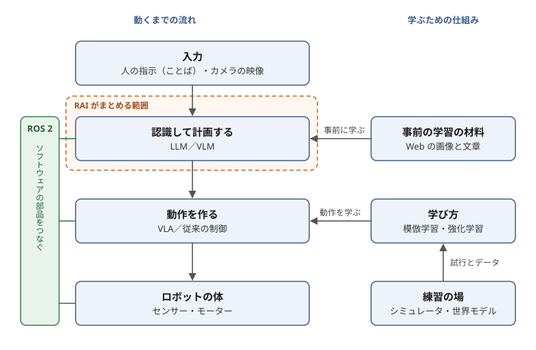
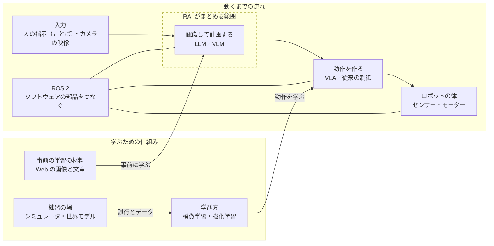

# フィジカルAI 入門

フィジカルAIの全体像を、5〜10分で読める分量でまとめた入門書です。用語の意味と、技術どうしの関係（地図）をつかむことを目的にしています。個々の技術の最新の情報は、[`topics/rai.md`](topics/rai.md)・[`topics/vlm.md`](topics/vlm.md)・[`topics/simulator.md`](topics/simulator.md) に、業界ごとの導入の状況は [`topics/industry.md`](topics/industry.md) に、NVIDIA が提供する開発の技術の全体像は [`topics/nvidia.md`](topics/nvidia.md) にまとめています。

> この入門書は、Claude Code（AI）が下書きし、リポジトリの管理者が確認したものです（[README の「ご利用の前に」](README.md#ご利用の前に)）。技術の大まかな関係を示すための説明なので、個々の製品・モデルの性能や対応範囲は、各テーマのファイルに載せた一次情報（開発元の発表・論文・公式のリポジトリなど、元の情報）で確かめてください。

## 0. この入門書で分かること

1. フィジカルAIが、ふつうの対話型の AI と何が違うのか
2. ロボットが動くまでの3つの働き（認識・計画・制御）と、それを身につける学び方
3. LLM・VLM・VLA・ROS 2 といった用語が、全体のどこに当たるのか
4. このリポジトリのテーマ（RAI・VLM・シミュレータ）が、その地図のどこにあるのか

## 1. フィジカルAIとは

台所に立つロボットに「テーブルの上の赤いコップを、流しに持っていって」と頼む場面を考えてみます。

文章で答えるだけの AI なら、手順を書き出せば仕事は終わりです。ところがロボットは、カメラの映像からコップを探し、手の届く位置まで近づき、割らない力加減でつかみ、途中で人が通れば止まらなければなりません。言葉を理解するだけでなく、**見て、考えて、体を動かす**ところまでが仕事になります。

このように、実世界で身体（ロボットの機体）を持って動く AI を、**フィジカルAI**と呼びます。近い言葉に Embodied AI（身体を持つ AI）があります。文章や画像で学んだ大きな AI モデルの知識をロボットの動きにつなげる研究と製品が、ここ数年で相次いで発表されています（[`topics/`](topics/) に載せた項目も、多くが 2023 年以降のものです）。

## 2. ロボットが動くまでの3つの働き

ロボットの中では、大まかに次の3つの働きがつながっています。1回で終わりではなく、動きながら何度も繰り返します（人が通れば、それを認識して計画を立て直します）。

| 働き | 何をするか | 台所の例では |
|---|---|---|
| 認識 | カメラやセンサーの情報から、周りの状況を読み取る | 赤いコップがどこにあるかを見つける |
| 計画 | 目的を達成するための手順を決める | 「近づく → つかむ → 運ぶ → 置く」と決める |
| 制御 | 計画を、モーターへの具体的な指令に変える | 腕の関節をどれだけ、どの速さで動かすかを決める |

これらを身につけさせる代表的な学び方は2つあります。**模倣学習**は、人が見せた手本（例えば、人がロボットを遠隔操作して見せた動き）をまねて学ぶ方法です。**強化学習**は、うまくいったら得点（報酬）を与え、試行錯誤を繰り返して得点が高くなるように学ぶ方法です。

どちらも、たくさん試す必要があります。実物のロボットで何万回も試すのは時間がかかり、壊れる心配もあります。そこで、仮想の空間でロボットを動かす**シミュレータ**で練習させる方法がとられます。映像などから「次に世界がどうなるか」を予測する**世界モデル**を、練習の場やデータを作る道具として使う動きもあります。

もう1つ、大きなモデルは、特定の用途（ロボットの動作など）のデータで学ぶ前に、Web の大量の画像と文章で一般的な知識を学んでおくのが一般的です。これを**事前の学習**（事前学習）と呼びます。

## 3. 技術の地図

ここまでの話を、1枚の地図にまとめます。左の列が、人の指示からロボットが動くまでの流れです。右の列が、それを学ぶための仕組みです。2節の「認識」と「計画」は「認識して計画する」の箱、「制御」は「動作を作る」の箱にあたります。2節で書いた繰り返しは省き、1回分の流れだけを描いています。

同じ図（mermaid版）

mermaid 版は自動で配置されるので、箱の並びが上の図と違うことがあります。この節の「左の列」「点線の枠」などの説明は、上の図を指しています。

左の列の言葉を、上から順に説明します（右の列の言葉は2節で説明しました）。

- **LLM**（大規模言語モデル）は、大量の文章で学んだ、言葉を理解して文章を作る AI です。対話型の AI の中身にあたります。文章だけを扱うので、ロボットでは主に、言葉の指示から手順を立てる計画を受け持ちます。
- **VLM**（Vision-Language Model）は、画像と言語をまとめて扱うモデルです。多くは LLM に画像を読む力を加えた形をとります。「この映像の中の赤いコップはどこか」「次に何をすべきか」を言葉で答えられるので、ロボットでは主に認識と計画を受け持ちます。
- **VLA**（Vision-Language-Action Model）は、VLM を土台にして、出力にロボットの動作（関節の目標の値など）を加えたものです。計画の箱を通さずに、カメラの映像と指示を直接受け取ることもでき（図では省いています）、Web で学んだ知識を体の動かし方に生かすことを狙っています。VLA を使わずに、従来の制御の方法（決められた計算で軌道を作る等）で動作を作ることもできます。
- **ROS 2**（Robot Operating System 2）は、ロボットのソフトウェアを小さな部品に分けて作り、部品どうしをメッセージでやり取りさせるための仕組みです（[公式のリポジトリ](https://github.com/ros2/ros2)）。名前に OS とありますが、Windows のような OS ではなく、その上で動く共通の土台（ミドルウェア）です。カメラの処理・地図づくり・腕の制御などを別々の部品として作り、組み合わせられます。
- **RAI**（点線の枠）は、LLM・VLM をロボットのソフトウェアにつなぐ枠組みです。このリポジトリのテーマの1つなので、4節で説明します。

計画を受け持つ VLM と、動作を受け持つ VLA を組み合わせる形もあります。例えば Google DeepMind の Gemini Robotics では、計画を立てる VLM（ER 2）が、開発者が「道具」として登録した VLA などに、実際の動作を任せます（[`topics/vlm.md` の「Gemini Robotics ER 2」](topics/vlm.md#gemini-robotics-er-2)）。

## 4. このリポジトリのテーマは地図のどこか

**VLM**（[`topics/vlm.md`](topics/vlm.md)）は、地図の「認識して計画する」の箱にあたります。そこから一歩進んだ VLA（「動作を作る」の箱）も、VLM と切り離せないので同じファイルで扱っています。世界モデルとしても使える大きなモデル（Cosmos 3）も載せています。

**RAI**（[`topics/rai.md`](topics/rai.md)）は、地図の点線の枠にあたります。RAI は、LLM や VLM を**エージェント**（目的に向けて自分で道具を選び、手順を進める AI のプログラム）として組み立て、ROS 2 で動くロボットにつなぐための枠組みです。VLM そのものを作るのではなく、既にある VLM や LLM を、ロボットのソフトウェアの中で使える形にします。音声の入出力・物体検出・シミュレータとの接続などの部品も備えています。なお、開発元によれば、多くの機能は ROS 2 がなくても使えます。図で、ROS 2 の帯から計画の箱への線が点線の枠をまたいでいるのは、RAI がこのつなぎ込みを受け持つことを表しています（ROS 2 そのものは RAI の一部ではありません）。

**シミュレータ**（[`topics/simulator.md`](topics/simulator.md)）は、地図の右の列の「練習の場」にあたります。シミュレータと一口に言っても、物体の動きを計算する中核の部分（**物理エンジン**）、その上で大量の試行を並列に回して学ばせる環境、ROS 2 で作ったソフトウェアを仮想の空間で試験する道具、と役割に違いがあり、組み合わせて使われます。`topics/simulator.md` では、特定のツールに偏らないよう、開発元や役割の違うものを並べています。

## 5. 次に読むもの

- どんなモデルがあるかを眺めるなら [`topics/vlm.md`](topics/vlm.md) の一覧表
- ROS 2 のロボットに AI を組み込む道具を知りたいなら [`topics/rai.md`](topics/rai.md)
- ロボットを仮想の空間で練習・試験させる道具を知りたいなら [`topics/simulator.md`](topics/simulator.md) の分類の表
- 工場・店・工事の現場・病院などで、実際にどこまで使われ始めているかを知りたいなら [`topics/industry.md`](topics/industry.md)
- 学習・シミュレーション・ロボットの上での実行の道具を一式で提供している例として、NVIDIA の技術の全体像を知りたいなら [`topics/nvidia.md`](topics/nvidia.md) の「3つの計算機」の表
- 実際に手を動かして、シミュレーションの中でロボットに動き方を学ばせたいエンジニアなら [`topics/isaac-lab.md`](topics/isaac-lab.md)（強化学習の基本を知っていることが前提）

## 用語集

| 用語 | 意味 |
|---|---|
| フィジカルAI | 実世界で身体を持って動く AI。近い言葉に Embodied AI がある |
| 一次情報 | 開発元の発表・論文・公式のリポジトリなど、元の情報 |
| 認識 | センサーの情報から周りの状況を読み取る働き |
| 計画 | 目的を達成するための手順を決める働き |
| 制御 | 計画をモーターへの具体的な指令に変える働き |
| 模倣学習 | 人が見せた手本をまねて学ぶ方法 |
| 強化学習 | 試行錯誤を繰り返し、得点（報酬）が高くなるように学ぶ方法 |
| シミュレータ | 仮想の空間でロボットを動かし、練習や試験をするソフトウェア |
| 物理エンジン | シミュレータの中で、物体の動き・接触・関節の力を計算する中核の部分 |
| 世界モデル | 「次に世界がどうなるか」を予測するモデル |
| 事前の学習（事前学習） | 特定の用途のデータで学ぶ前に、Web の大量の画像と文章で一般的な知識を学んでおくこと |
| LLM | 大量の文章で学んだ、言葉を扱う大規模なモデル |
| VLM | 画像と言語をまとめて扱うモデル |
| VLA | VLM を土台に、ロボットの動作まで出力するモデル |
| エージェント | 目的に向けて自分で道具を選び、手順を進める AI のプログラム |
| ROS 2 | ロボットのソフトウェアを部品に分け、部品どうしをつなぐための共通の土台（ミドルウェア） |
| RAI | LLM・VLM をエージェントとして組み、ROS 2 のロボットにつなぐ枠組み |

## 出典について

この入門書は、このリポジトリの [`topics/`](topics/) のファイルにまとめた一次情報と、一般に知られた技術の説明（2節の学び方、3節の LLM・ROS 2・従来の制御など）をもとに、このリポジトリが自分の言葉で書いたものです。第三者の文章や図は転載していません。図もこのリポジトリで作ったもので、文章と同じく [CC BY 4.0](LICENSE) で提供します。
